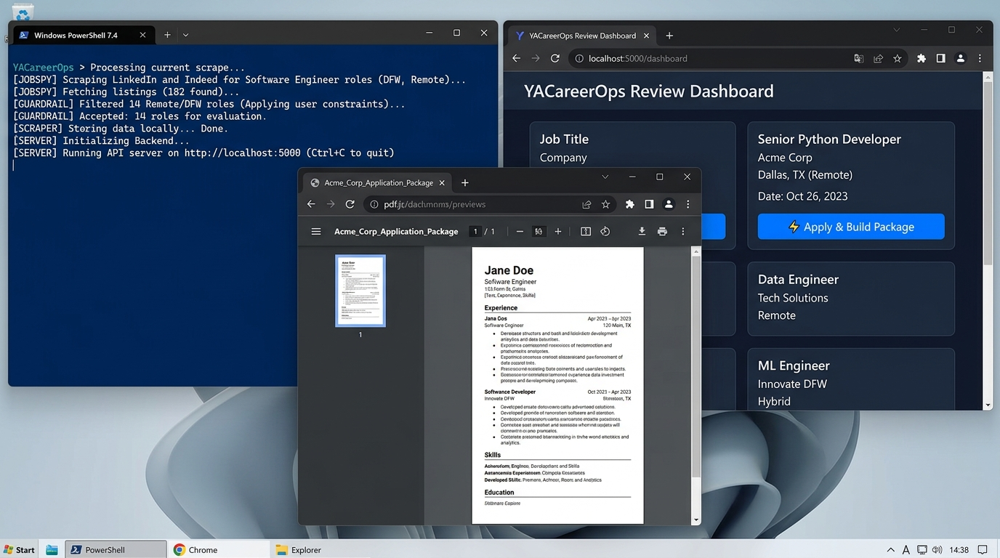
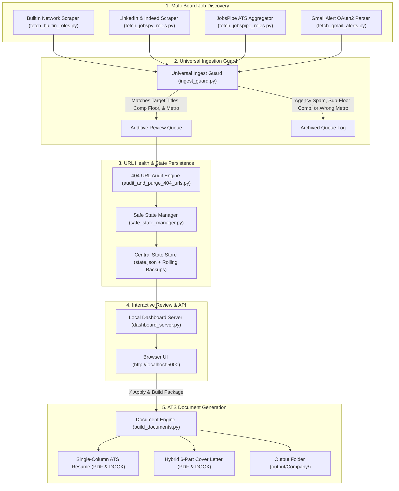

# 🎯 YACareerOps

[](https://www.python.org/)
[](LICENSE)
[](https://semver.org/)
[](#-system-architecture)
[](https://www.buymeacoffee.com/roadrashtx)

<a href="https://www.buymeacoffee.com/roadrashtx" target="_blank"></a>

---

## 🖼️ System Interface Mockup

<p align="center">
  
</p>

---

## 💡 Overview

**YACareerOps** is a local, privacy-first career automation platform. It combines live multi-board scraping (BuiltIn, LinkedIn, Indeed), direct ATS API ingestion (Greenhouse, Lever, Ashby, Workday), OAuth2 Gmail job alert ingestion, universal guardrail filtering, an autonomous background scheduler, system desktop notifications, and 1-click tailored ATS resume and cover letter generation into a single Python system.

> [!NOTE]
> **Human-in-the-Loop Safeguard**: Clicking **"⚡ Apply & Build Package"** builds your tailored single-column ATS PDF/DOCX resume and hybrid cover letter locally. It **does not** automatically submit forms on external job sites. You maintain 100% control to review your customized package before submitting it directly to the employer's portal.

---

## 🚀 5-Minute Quickstart

No manual JSON editing, no complex configuration, and no multi-terminal coordination.

### 1. Prerequisites
- [Python 3.10 or higher](https://www.python.org/downloads/) installed and added to PATH
- [Git](https://git-scm.com/downloads) (or download ZIP archive)

### 2. Download and Launch

Clone the repository and run the launcher for your operating system:

```bash
git clone https://github.com/Cask-Hound-Digital/job_search_agent.git
cd job_search_agent
```

- **Windows**:
  Double-click `start.bat` or run:
  ```cmd
  python start.py
  ```
- **macOS / Linux**:
  ```bash
  chmod +x start.sh
  ./start.sh
  ```

### 3. Complete First-Run Browser Setup
On first run, the launcher automatically:
1. Verifies Python 3.10+ compatibility.
2. Auto-installs any missing Python dependencies.
3. Starts the autonomous background scheduler and local dashboard server.
4. Opens your default web browser directly to the **Setup Wizard** (`http://localhost:5000/setup`).

Fill in your candidate name, email, salary floor, target job titles, and preferred workplace type. Once saved, you are redirected to the live dashboard.

---

## ⚙️ How It Works: What Happens When You Click "⚡ Apply & Build Package"?

When you review your job queue on `http://localhost:5000` and click **"⚡ Apply & Build Package"**:

1. **API Trigger**: The dashboard sends a request to your local background daemon server (`/api/apply`).
2. **Document Tailoring**: The document engine (`build_documents.py`) reads your candidate profile, work history, and target role data.
3. **Local File Generation**: Generates customized application files inside your local export directory (`output/[Company_Name]/`):
   - Single-Column ATS Resume (`.pdf`)
   - Editable ATS Resume (`.docx`)
   - Tailored 6-Part Hybrid Cover Letter (`.pdf`)
   - Editable Cover Letter (`.docx`)
4. **State Tracker Update**: Updates `state.json`, moving the role from the review queue into active tracked applications.
5. **Manual Submission**: You open the generated folder, review the tailored documents, and submit directly to the employer's portal.

---

## 🖥️ In-Dashboard Features

- **Match Scoring**: Every opportunity receives a composite match score (0-100) based on title similarity, seniority tier match, compensation headroom, and posting recency.
- **Posting Verification Badges**: Active postings display `✓ Verified` in green. Roles with expired signals or unavailable pages display `⚠️ Unconfirmed` in amber with the underlying verification reason.
- **On-Demand Search Trigger**: Click **⚡ Run search now** in the header at any time to run an immediate ingestion cycle without waiting for the scheduler.
- **Source Status Panel**: Toggle individual ingestion sources (BuiltIn, JobSpy, JobsPipe, Gmail) directly from the dashboard.
- **Desktop Alerts**: Get notified via native desktop toast notifications whenever newly vetted roles match your criteria.
- **In-Dashboard Settings**: Update salary floors, target titles, workplace alignment, or scheduler intervals directly in the UI via the **⚙️ Settings** modal.

---

## 💻 Terminal CLI Tool (`configure.py`)

If you prefer terminal workflows, configure the agent using `configure.py`:

- **Interactive Wizard**:
  ```bash
  python configure.py
  ```
- **Read Current Values**:
  ```bash
  python configure.py get scheduler.interval_hours
  python configure.py get candidate.min_salary_floor
  ```
- **Update Values with Validation**:
  ```bash
  python configure.py set scheduler.interval_hours 4.0
  python configure.py set candidate.min_salary_floor 190000
  python configure.py set search_matrix.target_titles "Director of Engineering, VP of Technology"
  python configure.py set sources.builtin true
  ```

---

## 📬 Gmail Job Alerts Integration (OAuth2)

YACareerOps supports ingesting job alert emails directly via Google's official Gmail API with OAuth2. No app passwords or IMAP credentials are used:

1. In the [Google Cloud Console](https://console.cloud.google.com), create a project and enable the **Gmail API**.
2. Create an **OAuth client ID** with Application type set to **Desktop app**.
3. Download the JSON credentials file as `credentials.json`.
4. Upload `credentials.json` in the First-Run Setup Wizard or Dashboard Settings, and click **Authorize with Google** to authenticate.

---

## 🏗️ System Architecture



---

## 🛡️ AppSec & Privacy Standards

- **Zero Remote Tracking**: All candidate state data (`state.json`) and generated application packages remain stored locally on your filesystem.
- **Strict Text Sanitization**: Text engines enforce a strict zero em-dash policy (` - ` stripped to hyphens or commas) to protect formatting across enterprise ATS parsers.
- **Atomic File Operations**: All configuration and state writes use temporary file creation and atomic replacement (`os.replace`) to eliminate file corruption risks.

---

## 🔧 Troubleshooting

Encountering an issue with ports, OAuth, notifications, or board connectivity?
See our complete [Troubleshooting Guide](docs/TROUBLESHOOTING.md) covering:
- Port 5000 in use conflicts and resolution.
- Google Cloud OAuth2 consent screen and credential setup.
- Empty queue diagnostics and filter tuning.
- Windows/macOS desktop notification settings.
- Background scheduler execution.

---

## 🧪 Advanced Operating Modes

### Standalone CLI Execution
Run search cycles or individual scraper modules manually:
```bash
python run_unified_search.py
python dashboard_server.py --daemon --port 5000
```

### Antigravity Multi-Agent Mode
When running inside Google Antigravity:
1. Load the `job-search-consultant` skill located in `.agents/skills/job-search-consultant/`.
2. Schedule a recurring search cycle:
   ```bash
   /schedule CronExpression="0 7,11,15 * * *" Prompt="Execute multi-board search cycle and sync dashboard."
   ```

---

## ☕ Support the Project

If YACareerOps helps you streamline your job search or build tailored applications, feel free to support the project:

[](https://www.buymeacoffee.com/roadrashtx)

---

## 🏷️ Release Versioning Policy & Governance

YACareerOps follows [Semantic Versioning (SemVer 2.0.0)](https://semver.org/).

| Release Tier | Version | Description |
| :--- | :--- | :--- |
| **Current Release** | `v2.4.0` | One-command launcher (`start.py`/`start.bat`/`start.sh`), first-run browser setup wizard, Gmail OAuth2 integration, match scoring (0-100), verification badges, in-dashboard settings, desktop alerts, and CLI tool (`configure.py`). |
| **Phase 3** | `v2.3.0` | Background daemon scheduler (`scheduler.py`), desktop notifications (`notifications.py`), Google Cloud OAuth2 client (`auth_gmail.py`), and CI testing pipeline. |
| **Phase 2** | `v2.2.0` | 6-part hybrid cover letter generator, full ATS resume builder, and multi-factor match scoring engine. |
| **Phase 1** | `v2.1.0` | Review queue deduplication, safe atomic state manager, and URL audit engine. |
| **Initial** | `v2.0.0` | Initial modular multi-board architecture and local web dashboard. |

---

## 📄 License

This project is open-source software licensed under the [MIT License](LICENSE).
